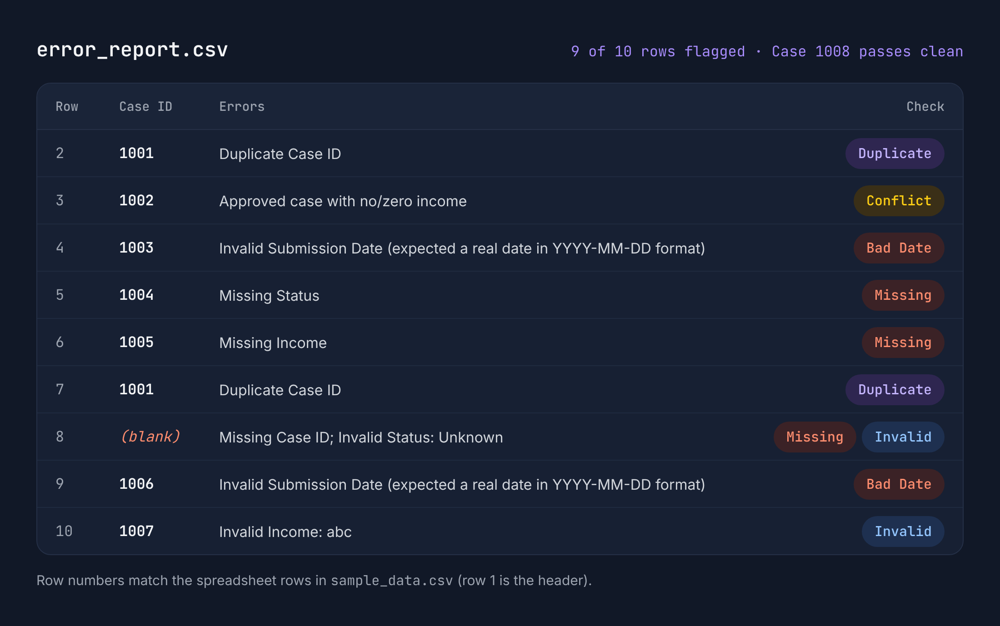

# 🕵️‍♂️ Data Validation Tool

Python tool for checking a CSV file for missing, invalid, and conflicting values before the data reaches QA review. Built for review teams who receive record data from another source and want every bad entry listed before review starts.

Each run applies field-level rules (required fields, allowed status values, real dates, numeric income, and approval rules) and writes every flagged row with its errors to `error_report.csv`.

## 🔍 What It Does

- Checks required fields (Case ID, Status, Submission Date, Income) for missing values
- Flags duplicate Case IDs
- Flags invalid status values (anything other than Approved, Pending, or Denied)
- Flags invalid submission dates, including wrong formats and dates that don't exist (expected YYYY-MM-DD)
- Flags non-numeric income values
- Flags rule conflicts, such as an approved case with no or zero income
- Generates `error_report.csv` listing each flagged row and its errors

## 🧪 Sample Data

[`sample_data.csv`](sample_data.csv) includes 10 records: 1 clean record and 9 with intentional errors, covering every check above. The clean record (Case ID 1008) is not flagged.

## 📊 Sample Output

Running the script on the sample data flags 9 of 10 rows. Row numbers match the spreadsheet rows in `sample_data.csv` (row 1 is the header).

## ✅ UAT Testing

Tested against 7 business rules with 21 UAT test cases covering the sample data, edge cases, and file checks.

| Total | Pass | Open Question | Fail |
|---|---|---|---|
| 21 | 18 | 2 | 1 |

See [`UAT_TEST_PLAN.md`](UAT_TEST_PLAN.md) for the business rules, test cases, results, defect log, and open questions.

## 🗂️ Known Limits

- **A row with an unquoted comma stops the run.** The script shows a parsing error and writes no report (DEF-01).
- **Formatted income gets flagged.** Values such as $900 or 1,200 fail the numeric check. The business rule needs confirmation (OQ-01).

## 🧰 Tools Used

- Python 3 (AI-assisted development)
- pandas
- datetime (standard library)

## 📁 File Overview

- [`data_validation_tool.py`](data_validation_tool.py) - Loads input data, applies validation rules, outputs results
- [`sample_data.csv`](sample_data.csv) - Test dataset with intentional errors
- `error_report.csv` - Generated output of flagged records (created when the script runs)
- [`images/error_report.png`](images/error_report.png) - Screenshot of the error report from the sample data
- [`UAT_TEST_PLAN.md`](UAT_TEST_PLAN.md) - UAT test plan with business rules, test cases, results, defect log, and open questions
- [`test_data/`](test_data) - Edge-case and file-check inputs used in UAT

## ▶ How to Use It

1. Install dependencies: `pip install pandas`
2. To use your own data, change `INPUT_FILE` in [`data_validation_tool.py`](data_validation_tool.py) to point to your file
3. Run `python data_validation_tool.py`
4. Review `error_report.csv` for flagged issues

## 📌 Purpose

Built from QA review work, where keying errors and missing fields slow down every case they touch. Running this first gives the reviewer a list of every problem row and what's wrong with each one, so review time goes to decisions instead of hunting for typos.
